# Решатель

**Одно приложение для школы: вставил уравнение или условие задачи — получил ответ с разбором по шагам.**
Работает офлайн и без сервера: код приложения — в одном файле `index.html`, распознавание с фото — в папке `lib/`.

[](LICENSE)
[](CHANGELOG.md)
[](#технические-детали)
[](#технические-детали)

<p align="center">
  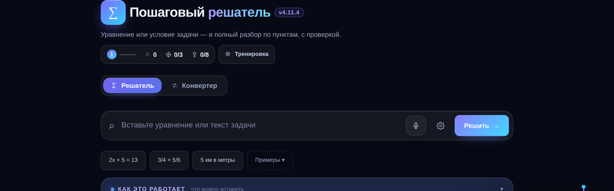
</p>

## Зачем это

Ученик вбивает `2x + 5 = 13` — и видит не просто «x = 4», а весь путь: перенос слагаемых, деление,
проверку подстановкой. Учитель собирает вариант на класс за минуту: листы для печати, ключ ответов,
PDF в чат класса. Всё это лежит на устройстве и не требует интернета — ни в кабинете без Wi-Fi,
ни в автобусе по дороге в школу.

## Возможности

| Раздел | Что делает |
|---|---|
| **Решатель** | Уравнения, примеры с дробями, проценты, единицы, геометрия, системы, текстовые задачи, линейная функция с графиком. Ввод — с клавиатуры, голосом или **с фото задачи**. Каждый ответ — с пошаговым разбором, проверкой и пояснением «почему так». Пока печатаешь, под полем видно, **как понят пример и какой будет ответ**; разбор можно смотреть коротко («Ответ»), подробно («По шагам»), совсем просто («Проще») или сразу решить похожую задачу. |
| **Тренировка** | Задания по 24 темам, адаптивная сложность, подсказки трёх уровней (направление → правило → шаг), проверка ответа и повторение по интервалам 1 → 3 → 7 → 16 → 30 дней. |
| **Конвертер** | 12 категорий единиц: длина, масса, площадь, объём, температура, давление, энергия, мощность, скорость, время, углы, валюта. С разбором, как получилось число. |
| **Тесты** | Пять заданий по теме с проверкой сразу; лучший результат по каждой теме виден на карточке. |
| **Класс** | Конструктор вариантов: класс, темы, число вариантов и заданий, листы A4 со строками для ответа, ключ для учителя, коды вариантов для раздачи. PDF и печать — в один клик. Ученик по коду решает ту же работу **в приложении** или на бумаге. |
| **Дэш** | Уровень и опыт, серия дней, квесты, награды, освоение тем полосками, слабые места, ошибки, контрольная, проверка уровня, отчёт для родителя. |

Дополнительно: четыре темы оформления (светлая, тёмная, неон, ретро), крупный шрифт,
голосовой ввод «словами → формула», озвучка разбора, экспорт прогресса в файл и перенос по коду,
свой генератор PDF с кириллицей, экспорт решения картинкой, PWA-режим и Android-приложение.

## Скриншоты

**Разбор по шагам** — с проверкой подстановкой и пояснением «Почему?» на каждом шаге:

<p align="center">
  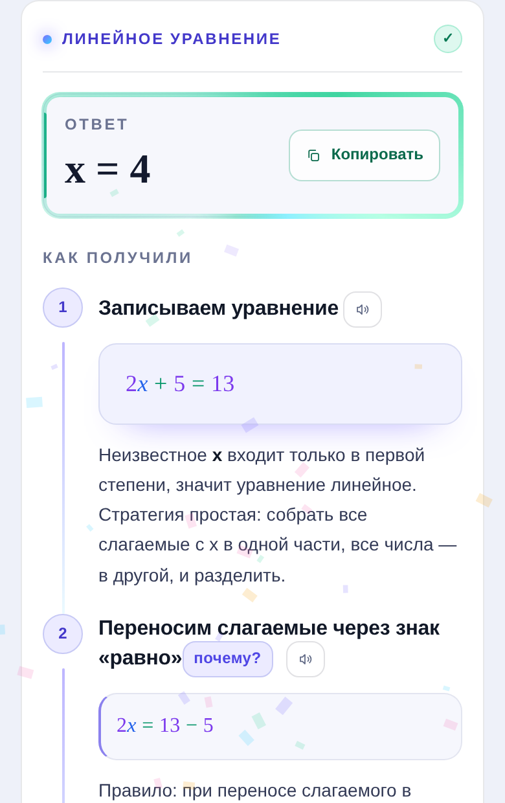
</p>

**Задача с фото** — офлайн-распознавание прямо в приложении: снимок → текст → решение.
Кнопка «фото» стоит слева в поле ввода, рядом с голосом:

<p align="center">
  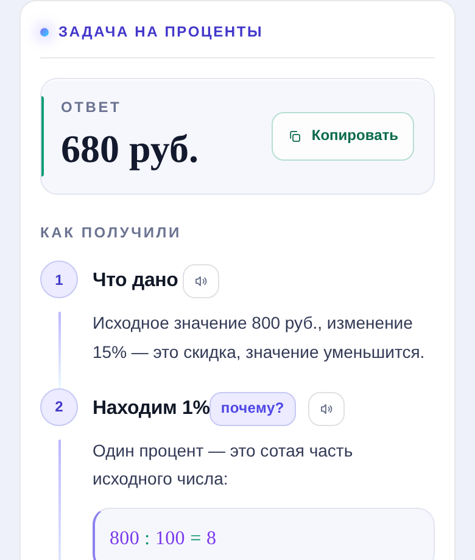
</p>

**График линейной функции** — SVG, а не картинка: масштаб квадратный, точки с подписями, таблица значений:

<p align="center">
  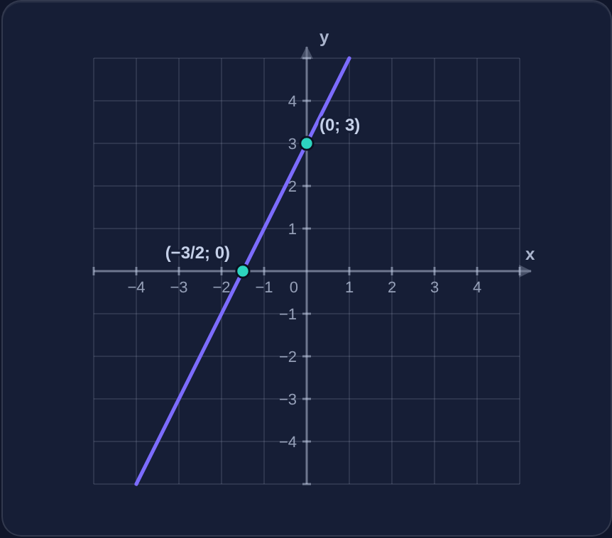
</p>

**Тренировка, тесты и прогресс** — подсказки, адаптивная сложность, освоение тем:

<p align="center">
  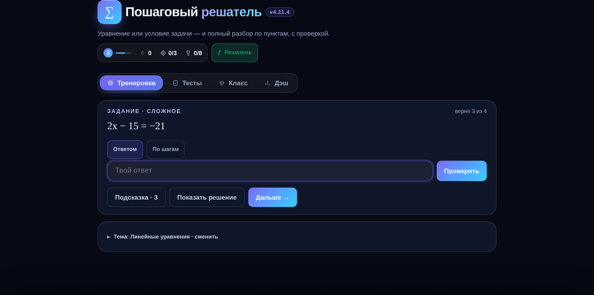
  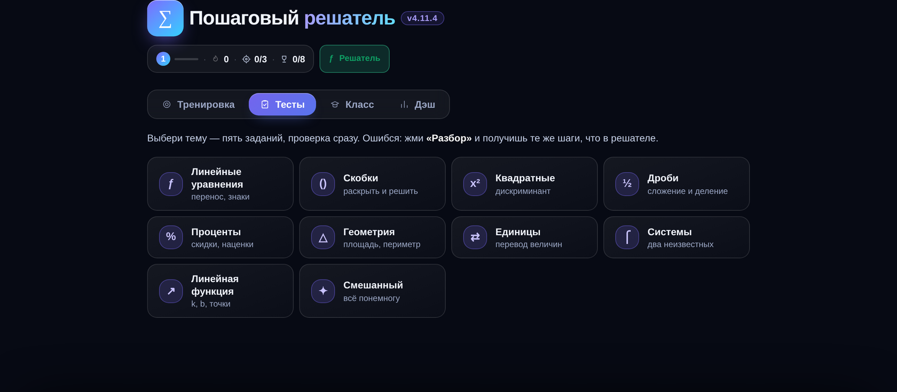
  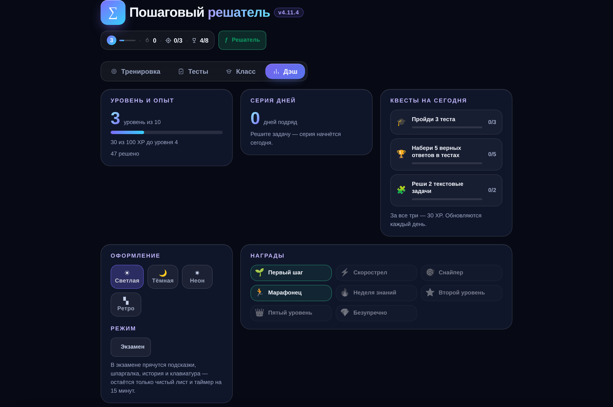
</p>

**Конструктор вариантов и лист для печати** — учитель собирает работу за минуту:

<p align="center">
  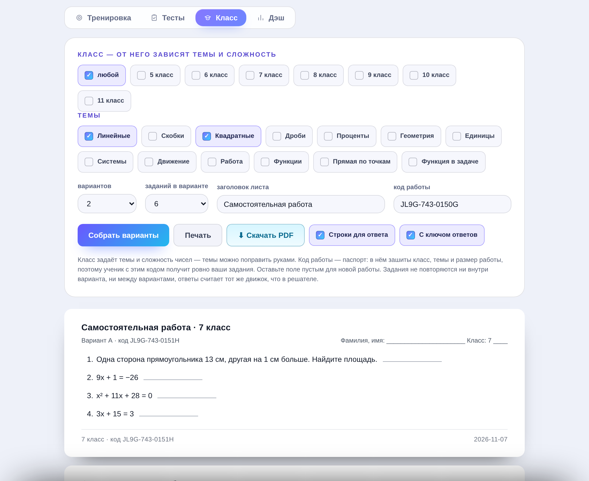
  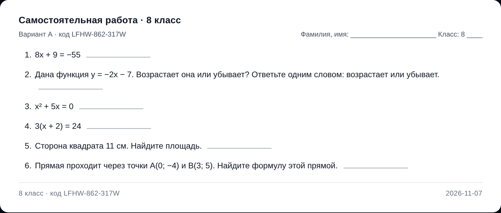
</p>

**Коды вариантов** — по одному на ученика; в коде зашит номер варианта:

<p align="center">
  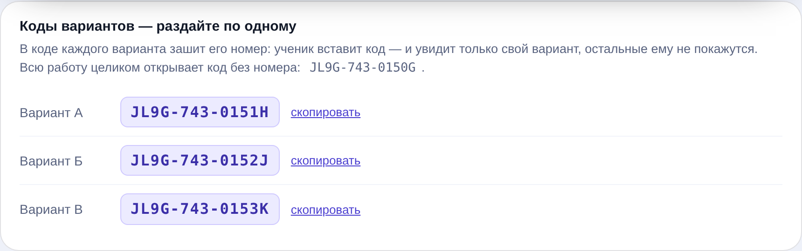
</p>

**Ученик по коду учителя** — своя работа, решает в приложении или на бумаге:

<p align="center">
  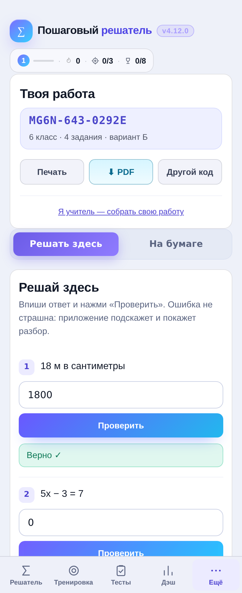
</p>

**Настройки — отдельный экран** — тема, ввод, экзамен, роль учителя:

<p align="center">
  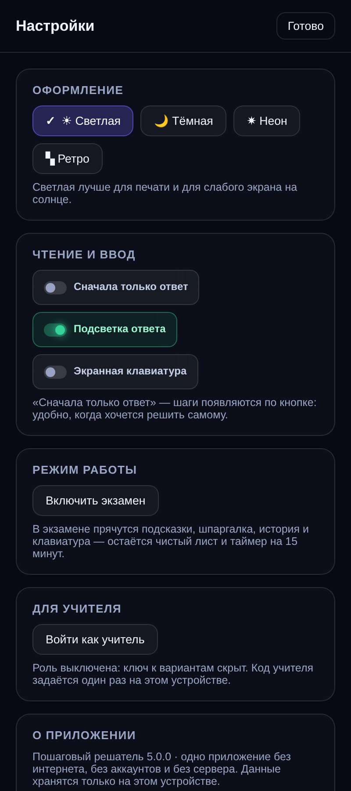
</p>

**Конвертер единиц** — 15 категорий, с разбором «как это считается»:

<p align="center">
  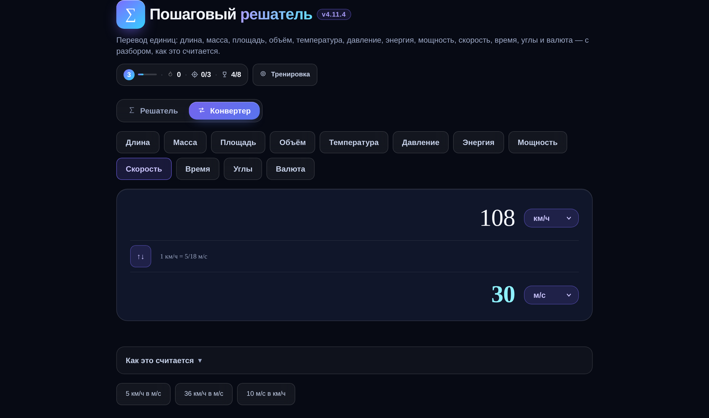
</p>

**Криптовалюта, данные, частота** — курсы по-прежнему вводятся вручную, без сети:

<p align="center">
  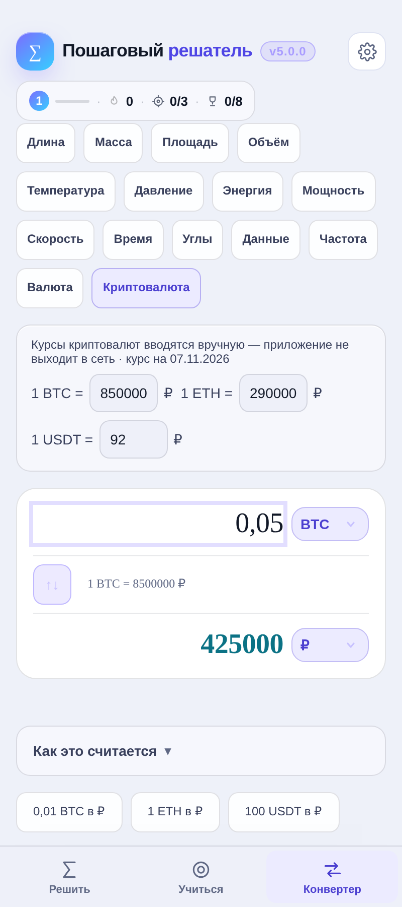
</p>

**На телефоне** — тот же файл, без отдельной сборки:

<p align="center">
  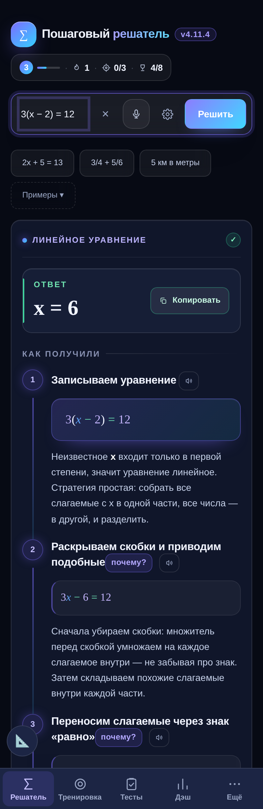
</p>

## Быстрый старт

Скачать и открыть — всё работает офлайн, интернет не нужен даже для первого запуска.

```bash
git clone https://github.com/arsi3000/RushPWA
cd RushPWA/reshatel
# открыть index.html в браузере — этого достаточно
```

Если нужен адрес `http://localhost` (для установки как приложения и проверки service worker):

```bash
python3 -m http.server 8080
# открыть http://localhost:8080
```

## Как пользоваться

1. Вставьте в поле уравнение (`2x + 5 = 13`), пример (`1/2 + 1/3`) или условие задачи
   («Турист шёл 2 часа со скоростью 5 км/ч. Какой путь он прошёл?»).
2. Нажмите Enter. Появится карточка с ответом и шагами; каждый шаг можно раскрыть и озвучить.
3. Не поняли шаг — откройте «Почему?» рядом с ним.
4. Хотите закрепить — раздел **Тренировка**: пять-десять заданий по теме, с подсказками.
5. **Дэш** показывает, что уже освоено, а что стоит повторить.

## Как устроено приложение

Три раздела на верхнем уровне — больше ничего не надо держать в голове:

| Раздел | Что внутри |
|---|---|
| **Решить** | Поле ввода, примеры, пошаговое решение, шпаргалка и история решений. |
| **Учиться** | Подтабы: **Тренировка** (свободно или на время), **Класс** (код работы, листы, конструктор), **Прогресс** (уровень, серия, квесты, награды, мои данные). |
| **Конвертер** | 15 величин: длина, масса, площадь, объём, температура, давление, энергия, мощность, скорость, время, углы, данные, частота, валюта, криптовалюта. |

Служебное — в шапке: **⚙ настройки** (оформление, ввод, экзамен, роль учителя) и пилюля прогресса,
которая ведёт в «Прогресс». На телефоне разделы стоят в нижней панели, на компьютере — сегментом в шапке.

## Конструктор вариантов и код работы

Раздел **Класс** (нужна роль учителя) собирает самостоятельную или контрольную работу:

- класс (5–11 или «любой») задаёт темы и сложность чисел;
- 14 тем на выбор, от «Линейные» до «Функция в задаче»;
- 1, 2, 3, 4 или 6 вариантов, по 3, 4, 5, 6, 8 или 10 заданий;
- листы A4 со строками для ответа, шапкой и местом для фамилии;
- ключ ответов отдельной страницей — только в роли учителя;
- **коды вариантов**: у каждого варианта свой код, кнопка «скопировать», код напечатан в шапке листа;
- «Скачать PDF» и «Печать» без диалогов и без интернета.

У каждой работы есть **код**, например `MG6N-643-0292E`. Он несёт базу, класс, число вариантов
и заданий, маску тем и **номер варианта**, поэтому на другом устройстве работа собирается **один в один** —
достаточно вставить код в поле «код работы». Ключ ответов ученику при этом не показывается: роль
учителя на его устройстве выключена. Старые коды без номера варианта (`…0…`, 13 знаков) понимаются
как «вся работа».

Ученик по коду выбирает, как решать:

- **«Решать здесь»** — под каждым заданием поле ответа и кнопка «Проверить»; ошибка не страшна:
  приложение подсказывает, даёт вторую попытку и открывает разбор по шагам; в конце — итог
  «N из M · P % · оценка» по школьной шкале 90/75/50;
- **«На бумаге»** — те же листы A4 для печати или PDF.

## Для учителя

Пошаговая методичка на 10 разделов — как включить роль учителя, собрать работу, проверить,
выгрузить и что делать, если что-то не работает: [инструкция-учителю.pdf](docs/methods-for-teacher.pdf).

Коротко о шкале. За верное задание — 1 балл, за неверное или пропущенное — 0. Дальше проценты:
**90–100 % — 5, 75–89 % — 4, 50–74 % — 3, ниже — 2**. В контрольной внутри приложения баллы дробные:
1 — решил сам, 0,5 — понадобилась подсказка, 0 — открыл разбор шага, так что «списал у подсказки»
не превращается в пятёрку.

## Разработчику

Приложение открывается как обычная страница, а в консоли браузера доступны отладочные точки входа:

```js
__selftest.open()          // прогон самопроверки: 5125 проверок движка и генераторов
__solve("2x + 5 = 13")     // один разбор, возвращает {kind, answer, steps}
__seedRandom(12345)        // зафиксировать ГПСЧ — задания станут воспроизводимыми
__dbg.GEN_KEYS             // список всех тем-генераторов
__clPdf.state()            // состояние конструктора вариантов
__clPdf.makeCode("K57X", 8, 6, 2, ["quad","frac"])   // собрать код работы
__LF                       // модуль линейной функции: разбор формул, график
__LEARN                    // прогресс: попытки, освоение, ошибки, контрольные
```

Устройство кода, схема данных и порядок добавления новой темы — в [ARCHITECTURE.md](ARCHITECTURE.md).
Что именно решается и по каким формулам — в [MATH.md](MATH.md). История версий — в [CHANGELOG.md](CHANGELOG.md).

## Структура репозитория

```
reshatel/
├── index.html              ← всё приложение: разметка, стили, движок, интерфейс
├── lib/                    ← распознавание с фото (tesseract.js 7 + русская модель), ~8,7 МБ
│   ├── tesseract.min.js
│   ├── worker.min.js
│   ├── tesseract-core-simd-lstm.wasm.js
│   └── rus.traineddata
├── sw.js                   ← service worker: офлайн-кэш, версия кэша в VERSION
├── README.md               ← этот файл
├── ARCHITECTURE.md         ← как устроен код
├── MATH.md                 ← темы, формулы и что приложение не умеет
├── CHANGELOG.md            ← история версий
├── LICENSE                 ← MIT
└── docs/
    ├── screenshots/        ← 15 скриншотов для README
    └── methods-for-teacher.pdf
```

PWA-манифест вшит в `index.html` как data-URI, поэтому отдельного `manifest.json` нет:
приложению хватает двух файлов.

## Технические детали

- **Один файл.** HTML, CSS и весь JavaScript — в `index.html` (~850 КБ). Ни сборки, ни npm, ни CDN.
- **Без сети.** Ни одного запроса наружу: шрифты, иконки и PDF-движок внутри. Курсы валют вводятся руками.
- **Хранение.** `localStorage`, схема данных версии 5 с миграциями; если браузер запрещает запись
  (приватный режим), приложение продолжает работать в памяти и предупреждает об этом.
- **PDF.** Свой генератор PDF с вшитым шрифтом DejaVu Sans — поэтому в файлах нормальная кириллица.
- **Печать.** Отдельные правила `@media print`: листы A4, без кнопок и фона, каждый вариант на своей странице.
- **Доступность.** Крупный шрифт, режим уменьшенной анимации, подписи `aria-*`, работа с клавиатуры.
- **Проверки.** Встроенная самопроверка: 5125 утверждений о движке, генераторах и разборе ответов.
- **Платформы.** Любой современный браузер (Chrome, Edge, Safari, Firefox), Android-приложение
  в WebView, установка как PWA.

## Чего приложение не делает

Честный список, чтобы не было сюрпризов:

- **Нет сервера и аккаунтов.** Прогресс живёт на устройстве ученика; учитель не видит результаты
  удалённо. Перенести прогресс можно файлом или кодом переноса.
- **Нет неравенств, тригонометрии, логарифмов, производных и интегралов.** Список тем — в [MATH.md](MATH.md).
- **Иррациональные ответы не выдаются «приблизительно»**: `√50` вернёт объяснение, что точного
  значения в обыкновенной дроби нет, а не подмену.
- **Свободный текст понимается по шаблонам.** Формулировку «сколько процентов составляет 30 от 150»
  приложение не разберёт — нужна привычная ему («скидка 20 % на 1500»). Подробности и примеры — в [MATH.md](MATH.md).
- **Символьные преобразования** (раскрыть скобки, разложить на множители) не выполняются:
  буквенные выражения решаются только как уравнения.

## Сборка Android-приложения

APK — тонкая WebView-обёртка (`com.kibersolver.app`) вокруг того же `index.html`, с мостом
`window.ReshatelApp.savePdf` для сохранения PDF на телефон. Порядок сборки и подписи:
[ARCHITECTURE.md → Сборка APK](ARCHITECTURE.md#15-сборка-apk).

## Лицензия

MIT — можно использовать, изменять и распространять, в том числе в школе и в коммерческих целях.
Подробности в [LICENSE](LICENSE).

Автор: [arsi3000](https://github.com/arsi3000).
